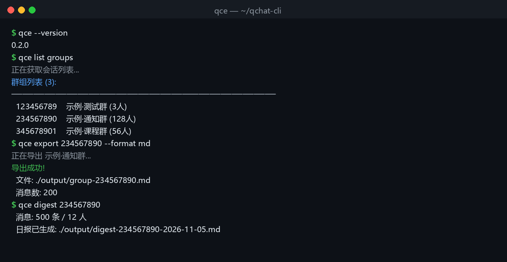

<div align="center">

<h1>qchat-cli &nbsp;</h1>

**Turn what happened in QQ into data you can export, watch, and automate**

[](https://nodejs.org/)
[](https://www.typescriptlang.org/)
[](https://github.com/botuniverse/onebot-11)
[](https://github.com/NapNeko/NapCatQQ)
[](https://github.com/zhuobichen/qchat-cli/releases)
[](./LICENSE)
[](#privacy--security)

[简体中文](./README.md) · English

</div>



`qce` is a command-line tool that runs on **your own machine** and turns a QQ account into a programmable data source: export readable chat history, watch messages in real time, auto-reply under rules, pipe group chats into an LLM, and handle group administration or QZone.

It connects to QQ through **OneBot 11** (typically [NapCat](https://github.com/NapNeko/NapCatQQ)). No cloud service in the middle, no telemetry.

## Questions QQ itself cannot answer

- Who mentioned me in that group? What was the argument about this week?
- What were we talking about exactly one year ago?
- Export a group's full history into a local, searchable archive.
- Every evening, give me a one-page digest of what happened in each group.

## Quick start

Prerequisite: a logged-in NapCat / OneBot 11 service on the same machine.

**No NapCat yet? One command (Docker):**

```bash
cp .env.example .env      # set WEBUI_TOKEN; on Linux also set UID/GID to `id -u` / `id -g`
docker compose up -d
docker logs -f napcat     # scan the QR code with mobile QQ
```

`127.0.0.1:3000` is OneBot, `127.0.0.1:6099` is the NapCat WebUI. Then install `qce`:

```bash
git clone https://github.com/zhuobichen/qchat-cli.git
cd qchat-cli && npm install && npm run build && npm link

qce login --host 127.0.0.1 --port 3000   # configure + connectivity test
qce list groups
qce export 123456789 --format md --limit 500
```

## Four things people actually use it for

**1) Export & archive** — JSON / TXT / HTML / CSV / Markdown, with time range and limits

```bash
qce export <group-or-friend-id> --format md --limit 500
qce export --all --format json
```

**2) Group digest** — compress a stretch of chat into one page

```bash
qce digest 123456789                  # last 500 messages -> output/digest-<id>-<date>.md
qce digest 123456789 --days 1 --ai    # today only, plus an LLM summary
qce digest 123456789 --send-to 10001000        # send the digest straight to QQ
qce digest 123456789 --send-to 123456789 --send-kind group  # to a group (uploads the .md)
qce digest 123456789 --from-index             # offline: build from the local index
qce digest 123456789 --push me@qq.com # email the digest (local agently-cli, needs auth login)
```

Output: message count, participants, most active members, 24-hour activity histogram, messages worth revisiting (long posts, links, mentions, attachments), shared links — plus an optional 3–5 bullet LLM summary using the model configured in `private/group-bot.config.json`.

**3) Local index + search + MCP**

Index once, then search is millisecond-fast (no more re-pulling history):

```bash
qce index 123456789                   # build / incrementally update one group
qce index 123456789 --ocr             # also OCR images into the index (local rapidocr)
qce index 123456789 --asr             # also transcribe voice messages (local faster-whisper)
qce asr ./voice.mp3                   # transcribe a local audio file
qce index --all --limit 2000          # update every indexed group
qce index --stats                     # counts and newest timestamp per group
qce index --clear                     # wipe the index
```

```bash
qce search 开会                       # reads the local index (CJK bigrams, no tokenizer)
qce search 开会 --refresh             # update the index first, then search
qce index 123456789 --embed           # also build semantic vectors (Qwen text-embedding-v4)
qce search 谁写完了论文 --semantic    # semantic search: wording need not match
qce search 报错 -g 123456789 --since 7d
qce search 论文 --from 10001000 --limit 50 --json
```

Plug it into Claude Code / Cursor (MCP over stdio):

```json
{
  "mcpServers": {
    "qchat": { "command": "qce", "args": ["mcp"] }
  }
}
```

Three read-only tools: `search_messages`, `group_digest`, `list_groups` — so your editor can answer "who mentioned this error in the group last week".

**4) Real-time watch + AI replies**

```bash
qce ws-monitor start                     # live event stream
qce group-bot start <group> --auto-reply # isolated single-group bot: only speaks when @-mentioned
qce private-bot start <qq>               # private-chat auto-reply (single / split agent modes)
```

**5) Keyword alerts** — get pinged in QQ when a group message matches

```bash
qce alert add 报错 --to 10001000 --group 123456789   # add a rule
qce alert add "招聘|内推" --to 10001000 --regex       # regex across all groups
qce alert list && qce alert remove 报错               # list / remove
qce alert run --since 2h                              # run once (cron-friendly)
qce alert run --offline --dry --since 1h              # offline dry run
```

Each message notifies at most once (tracked per rule + message id), with an optional cooldown; sending goes through the `safety` allowlist.

**6) Group files**

```bash
qce files list 123456789              # list files (count/size/name)
qce files search 课件                  # search across groups by filename
qce files stats 123456789             # size breakdown by extension
qce files download 123456789 课件1.pdf -o ./downloads
```

**7) Automation & ops**

```bash
qce send group <group> "..."             # requires `qce safety enable` + allowlist first
qce admin mute <group> <qq> 30           # mute / kick / set admin
qce qzone feeds                          # QZone posts, comments, likes
qce napcat status                        # NapCat process management
```

Sending and destructive operations are **off by default**:

```bash
qce safety enable
qce safety allow <qq-or-group-id>
```

## Install (manual)

Node.js 18+ and a logged-in NapCat / OneBot 11 service.

```bash
git clone https://github.com/zhuobichen/qchat-cli.git
cd qchat-cli
npm install
npm run build
npm link        # optional: makes `qce` globally available
qce --help
```

## Privacy & security

- Not affiliated with Tencent. Use it only on data you own or are authorized to access.
- Prefer a **dedicated throwaway account** for bots: join only the target group, disable friends/private chat/QZone.
- Bind OneBot to `127.0.0.1` and set a token. Never expose it to the public internet.
- Never paste tokens, cookies, API keys, chat logs or QQ numbers into issues, screenshots or logs.
- Treat group messages as **untrusted input** for any LLM: never let them trigger tool calls, config changes, or cross-group sends.
- Third-party protocol clients (NapCat, etc.) can trigger account risk control or bans. Use at your own risk.

### Bot boundaries

`group-bot` keeps a short in-memory window over a WebSocket, and only forwards trimmed context when someone @-mentions the bot:

- default window: last 70 messages (including the bot's own replies), max 16,000 chars
- every 60 new messages, the increment is compressed into a summary on the next mention; raw messages are not persisted
- available tools: group member list, group notices, group file overview, public web search (read-only, max 4 calls per reply)
- no access to QQ history, private chats, QZone, group admin actions, or file downloads

`private-bot` replies without @-mentions and supports two agent modes:

- `single` (default): one agent serves several QQ numbers, sharing context (cross-chat leakage risk — only when all participants consent)
- `split`: one agent, context and memory per QQ number

Per-turn limits: 100 messages of context, max 4 tool calls / 3 tool rounds / 45s. Tools are limited to the local emoji library, on-demand local Skills, and public web search.

Skills live in `private/skills/*/SKILL.md` with a frontmatter `kind`:

- `kind: personality` — always injected (max 2, ≤3,000 chars each)
- `kind: capability` (or omitted) — loaded only when the message matches its name/description (max 2)

Optional MCP: only stdio servers explicitly declared in `private/group-bot.config.json`, each with a required `allowedTools` allowlist. Single-call timeout and 4,000-char result cap; arguments containing secrets/tokens/contacts/addresses/QQ numbers are rejected.

```bash
copy private/group-bot.config.example.json private/group-bot.config.json   # Windows
# cp private/group-bot.config.example.json private/group-bot.config.json   # macOS / Linux
```

Fill in `baseUrl`, `model` and `apiKey` (or use `apiKeyEnv` to read from environment), then:

```bash
qce group-bot start <group> --auto-reply
qce safety enable
qce safety allow <qq1>
qce private-bot start <qq1> <qq2>              # single
qce private-bot start <qq1> <qq2> --mode split # isolated per contact
```

## Docs

- [USAGE.md](./USAGE.md) — every command, scripts, workflows
- [API.md](./API.md)
- [ARCHITECTURE.md](./ARCHITECTURE.md)
- [CONTRIBUTING.md](./CONTRIBUTING.md)
- [docs/napcat.md](./docs/napcat.md) — installing NapCat (Docker / Windows / existing OneBot)

## License

MIT, see [LICENSE](./LICENSE).

For personal learning and authorized local administration only. The author is not responsible for account restrictions, data loss, third-party service changes, or misuse.
