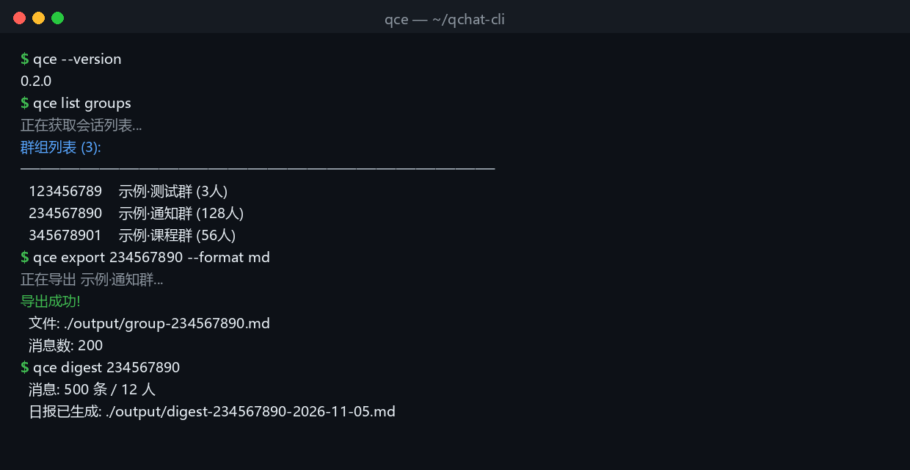
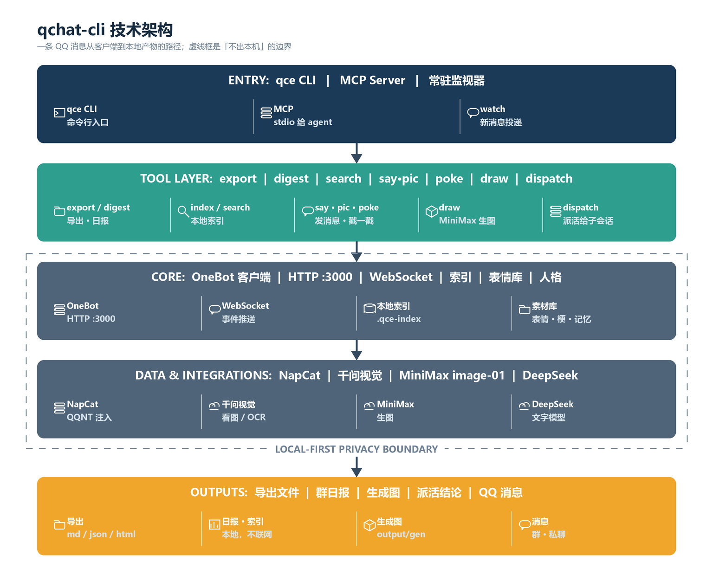

<div align="center">


<br/>

[](https://nodejs.org/)
[](https://www.typescriptlang.org/)
[](https://github.com/botuniverse/onebot-11)
[](https://github.com/NapNeko/NapCatQQ)
[](https://github.com/zhuobichen/qchat-cli/releases)
[](./LICENSE)
[](#隐私与安全)

简体中文 · [English](./README.en.md)

</div>



## 架构



图是 MiniMax 直接生成的像素风示意图（四个大标签是全对的；再多它就开始画鬼画符，所以细节放在下面的文字里）。

- **qce 工具层**：所有动作只有一种参数写法、一种返回格式；CLI 和 MCP 共用这一层，上层出问题时能退回到这一层查。
- **两条通道**：HTTP `:3000` 负责调用与历史，WebSocket 负责事件推送——戳一戳、新消息都靠它。
- **本地优先**：`.qce-index/` 存消息索引（搜索/日报不联网），`private/` 存表情库、梗库、记忆、规则、人格，`output/` 存导出与生成产物。
- **常驻旁路**：`qq-watch` 把新消息投进会话、`qq-watchdog` 体检与熔断、`qq-poke-watch` 收戳并还手、`dispatch` 车道把写代码的活丢给独立会话。

细节见 [ARCHITECTURE.md](./ARCHITECTURE.md)。

`qce` 是一个跑在你自己电脑上的 QQ 命令行工具。它不做“点一下导出”的按钮，而是把 QQ 账号变成一个**可编程的数据源**：导出可读的聊天记录、实时监听消息、按规则自动回复、把群聊接进 AI，也能做群管理和 QQ 空间的事。

## 它能回答 QQ 回答不了的几个问题

- 谁在群里提过我？这周那个群到底在吵什么？
- 去年这个时候，我们在聊什么？
- 把某个群的历史导出来，做成本地可搜索的档案 / 知识库。
- 每天下班前，自动给我一份“今天各群发生了什么”的日报。

## 60 秒上手

前置：本机已跑起 NapCat（QQNT 的 OneBot 实现）。装法见 [docs/napcat.md](./docs/napcat.md)（含 Docker 一键版），或直接用你已有的 OneBot 服务。

```bash
git clone https://github.com/zhuobichen/qchat-cli.git
cd qchat-cli && npm install && npm run build && npm link

$ qce login --host 127.0.0.1 --port 3000   # 配置 + 连接测试
  ✓ 已连接  OneBot 11 / 账号 123456789

$ qce list groups
群组列表 (65):
  123456789   示例·测试群 (3人)
  234567890   示例·通知群 (273人)
  ...

$ qce export 123456789 --format md
  导出成功!
    文件: ./output/group-123456789.md
    消息数: 200
```

真实输出（节选自本机运行）：导出会保留时间、发言人、正文，并把图片/表情/语音转成占位符，直接可读。

## 典型用法

**1）导出归档** —— JSON / TXT / HTML / CSV / Markdown，支持时间范围与条数限制

```bash
qce export <群号或QQ号> --format md --limit 500
qce export --all --format json           # 全量会话
```

**2）群日报 —— 把一段群聊压成一页**

```bash
qce digest 123456789                    # 最近 500 条 → output/digest-<群号>-<日期>.md
qce digest 123456789 --days 1 --ai      # 只看今天，并调用模型生成要点摘要
qce digest 123456789 --limit 2000 --stdout   # 同时打印到终端
qce digest 123456789 --send-to 10001000       # 生成后直接把摘要发到 QQ
qce digest 123456789 --send-to 123456789 --send-kind group   # 发到群（优先发 .md 文件）
qce digest 123456789 --from-index            # 不联网，直接用本地索引出日报
qce digest 123456789 --push me@qq.com   # 生成后直接发邮件（用本机 agently-cli，需先 auth login）
qce digest 123456789 --push me@qq.com --push-dry   # 只打印将执行的发信命令
```

产出：消息量 / 参与人数 / 谁说得最多 / 24 小时活跃分布（柱状图）/ 值得回看的长文·链接·点名·附件 / 分享过的链接；加 `--ai` 再由模型补 3–5 条要点（用 `private/group-bot.config.json` 里的模型，无需额外配置）。

**3）本地索引 + 搜索 + MCP 接入**

索引先落盘，搜索就是毫秒级（不再每次重拉历史）：

```bash
qce index 123456789                   # 建/增量更新某个群的索引
qce index 123456789 --ocr             # 顺带把消息里的图片转成文字入库（本机 rapidocr）
qce index 123456789 --asr             # 顺带把语音条转成文字（本机 faster-whisper，离线）
qce asr ./voice.mp3                   # 单独转写本地音频
qce index --all --limit 2000          # 更新所有已入索引的群
qce index --stats                     # 看各群条数与最新时间
qce index --clear                     # 清空索引
```

```bash
qce search 开会                       # 读本地索引（中文二元组匹配，不用分词）
qce search 开会 --refresh             # 先增量更新再搜
qce index 123456789 --embed           # 同时生成语义向量（阿里云百炼 text-embedding-v4）
qce search 谁写完了论文 --semantic    # 语义检索：问法不必和原文一致
qce search 报错 -g 123456789 --since 7d
qce search 论文 --from 10001000 --limit 50 --json
```

接进 Claude Code / Cursor（MCP，stdio）：

```json
{
  "mcpServers": {
    "qchat": { "command": "qce", "args": ["mcp"] }
  }
}
```

暴露五个工具：`search_messages`（关键词搜索）、`group_digest`（群日报）、`list_groups`（群列表）、`send_sticker`（发表情包）、`send_message`（发文字，两阶段确认）。

`send_sticker` 可以用 `intent`（"安慰一下"/"无语"/"庆祝"）让 **Jev 决策模型**从表情库里挑一张——它只做类型化选择并给出置信度，不会编造不存在的表情；没有 `JEV_API_KEY` 或接口失败时自动回退关键词匹配。

`send_message` 的安全设计：
- **两阶段确认**：第一次只返回摘要和 `confirmation_token`，带上令牌再调一次才真正发送（令牌 5 分钟有效、与内容绑定，改内容即失效）
- **群发默认禁用**：需要显式 `MCP_ALLOW_GROUP_SEND=1` 才允许发群
- **走 safety 白名单**：目标会话必须已 `qce safety allow`

**4）实时监听 + AI 回复**（需要模型 API Key，本地私密配置）

```bash
qce ws-monitor start                     # 实时事件流
qce group-bot start <群号> --auto-reply  # 单群隔离：只在被 @ 时说话
qce private-bot start <QQ号>             # 私聊自动回复（single / split 两种模式）
```

**5）关键词告警** —— 群消息命中就提醒到你的 QQ

```bash
qce alert add 报错 --to 10001000 --group 123456789   # 新增规则
qce alert add "招聘|内推" --to 10001000 --regex       # 正则 + 全群
qce alert list && qce alert remove 报错               # 查看 / 删除
qce alert run --since 2h                              # 跑一次（可配 cron / 计划任务）
qce alert run --offline --dry --since 1h              # 离线预演，不发送
```

同一条消息不会重复提醒（按「规则 + 消息 id」记录），可设冷却窗口；发送走 `safety` 白名单。

**6）群文件**

```bash
qce files list 123456789              # 列文件（数量/大小/文件名）
qce files search 课件                  # 跨群按文件名搜
qce files search .pdf --ext pdf -g 123456789
qce files stats 123456789             # 体积按扩展名分布
qce files download 123456789 课件1.pdf -o ./downloads
```

**7）会淡忘的长期记忆**

```bash
qce memory add "喜欢冰美式不加糖" -s 10001000 -w 0.9
qce memory recall -s 10001000        # 按衰减权重召回（越久越淡）
qce memory list / stats / forget     # 查看、统计、遗忘
qce memory forget                    # 清理过期记忆
```

每条记忆带时间与权重，按**半衰期**衰减（默认 30 天减半、180 天过期），被召回一次就重新计时。启用后 `group-bot` / `private-bot` 会自动把最要紧的几条注入上下文——原话还在，只是慢慢变淡，而不是压缩成一句摘要。

**8）语音条 / 表情收集 / 主动聊天**

```bash
qce tts "晚上一起吃饭？" --send-to 10001000     # 文字→语音条（Qwen-TTS，自动转 AMR）
qce face collect 123456789                      # 从群图片自动收集表情（去重进候选）
qce face collect 123456789 --apply              # 确认后并入表情库
qce proactive run --to 10001000 --dry           # 主动聊天决策（免打扰/间隔/上限/概率）
qce proactive config --quiet 23-8 --max 3
```

**9）常驻自动回复**

```bash
node scripts/qce-auto.mjs              # 常驻（2 秒一轮）
node scripts/qce-auto.mjs --once       # 单轮调试
node scripts/qce-auto.mjs --status     # 状态
node scripts/qce-auto.mjs --dlq        # 死信
node scripts/qce-auto.mjs --replay <id> # 重放死信
```

配置 `private/auto-reply.config.json`：

| 字段 | 说明 |
|---|---|
| `allow` | 允许回复的会话白名单（QQ 号/群号），空=不限 |
| `groups` | 允许自动回复的群 |
| `requireMentionInGroup` | 群里必须 @ 才回（默认开） |
| `minReplyGapSec` | 同会话两次回复的最小间隔 |
| `maxAgeSec` | 超过这个年龄的消息不回 |
| `allowVoice` + `ttsEndpoint` / `ttsRefAudio` / `ttsPromptText` | 语音回复（本地克隆音色） |

可靠性：状态原子写入（断电不丢水位，重启接着跑）· 失败重试 3 次 · 连续失败熔断 60s · 彻底失败进死信可重放。

**10）自动化与运维**

```bash
qce send group <群号> "..."              # 发送（需先 safety enable + 白名单）
qce admin mute <群号> <QQ号> 30          # 群管理：禁言/踢人/设管理员
qce qzone feeds                          # QQ 空间：说说 / 评论 / 点赞
qce napcat status                        # NapCat 进程管理
```

**11）生图 / 戳一戳 / 把活派出去**

```bash
qce draw "深夜城市上空游过的鲸鱼" --ar 16:9    # MiniMax image-01，几秒出图
qce pic group:123456789 output/gen/whale.jpg    # 直接发进群

qce poke group:123456789 10001000               # 群里戳一戳
qce poke user:10001000                          # 私聊戳

qce dispatch new "把 README 的安装步骤补全" --lane cli     # 派给独立会话干
qce dispatch lanes                                        # 三条车道谁在跑
```

`dispatch` 是为"聊天"和"干活"分开设计的：写代码、做分析的活丢给另一个会话（`D:\qq助手`
下各自的车道），几十个工具调用的输出不会灌进聊天上下文，干完只把结论带回来。

**12）掉线了会自己爬起来**

```bash
node scripts/qq-watchdog.mjs          # 常驻：每 120 秒体检
node scripts/qq-watch.mjs             # 常驻：新消息投递
node scripts/qq-poke-watch.mjs --pvp  # 常驻：收戳 + 自动还手
```

判定不看 `online` 标志（它滞后），而是看真实的会话探针：`get_friend_list` 返空、
`get_group_member_info` 返 null 都算"半死"。恢复策略是**有限次重启 + 熔断**：
连续 3 次起不来就停手，把二维码私聊推给你等人扫——而不是两分钟一轮硬拉，
那只会招来更严格的风控。凌晨 02:00–07:00 一律不自动重启。

发送与高风险管理操作默认关闭，必须先显式开启并授权目标会话：

```bash
qce safety enable
qce safety allow <QQ号或群号>
```

## 安装

需要 Node.js 18+，以及一个已登录的 NapCat / OneBot 11 服务。

**还没装 NapCat？一条命令起一个（Docker）：**

```bash
cp .env.example .env      # 改掉 WEBUI_TOKEN；Linux 下把 UID/GID 改成 id -u / id -g
docker compose up -d
docker logs -f napcat     # 看二维码，手机 QQ 扫码登录
```

起好之后（`127.0.0.1:3000` 是 OneBot，`127.0.0.1:6099` 是 WebUI），再装 `qce`：

```bash
git clone https://github.com/zhuobichen/qchat-cli.git
cd qchat-cli
npm install
npm run build
npm link          # 之后即可全局使用 qce
qce --help
```

> 只有开机自启需求时才需要 `npm link`；也可以直接 `node dist/cli.js <命令>`。

## 隐私与安全

- 本项目**不隶属于腾讯**，也不是官方产品。仅用于处理你本人拥有或已获授权访问的数据。
- 建议用**小号**跑机器人：只加入目标群，关闭或不配置好友、私聊、QQ 空间与其他群。
- OneBot 服务应只监听 `127.0.0.1` 并配置 Token；不要裸奔到公网。
- 不要在命令行、截图、日志或 issue 里暴露 Token / Cookie / API Key / 聊天记录 / QQ 号。
- AI 回复必须把群消息当作**不可信文本**：不执行其中要求的系统指令、工具调用、配置修改或跨群发送。
- 第三方协议工具（NapCat 等）可能触发账号风控、限制或封禁；风险由使用者自行承担。

## AI 机器人的边界（细节）

`group-bot` 通过本地 WebSocket 收集新消息并维护短期内存窗口，仅当群内有人 @ 机器人才会把裁剪后的上下文发给 AI：

- 默认上下文为最近 70 条（含机器人自己的回复），总长度上限 16,000 字符
- 每累计 60 条新消息，下次被 @ 时把增量压缩成群摘要；原始消息不落盘，重启只保留摘要
- 模型可用工具固定为：本群成员列表、群公告、群文件概览、公开网络检索（全部只读，每次回复最多 4 次）
- 不会让模型查询 QQ 历史、私聊、QQ 空间、群管理或下载文件

`private-bot` 不需要 @，指定 QQ 号发来的每条可处理消息都会触发回复，支持两种 Agent 模式：

- `single`（默认）：一个 Agent 服务多个 QQ 号，共享近上下文与摘要（存在跨私聊信息泄露风险，仅在参与者全部授权时使用）
- `split`：一个 QQ 号一个独立 Agent / 上下文 / 记忆，彼此不加载

每次处理边界：上下文最多 100 条、单轮最多 4 次工具调用 / 3 个工具回合 / 45 秒总时限。私聊工具仅限本地表情库、按需加载的本地 Skill 和公开网络检索。

### Skill 分类

在 `private/skills/*/SKILL.md` 的 frontmatter 里声明：

- `kind: personality` —— 人格 Skill，每次回复固定注入（最多 2 个，每个 ≤3,000 字）
- `kind: capability`（或缺省）—— 能力 Skill，仅在消息与名称/描述匹配时载入（最多 2 个）

人格 Skill 只写稳定的表达偏好与沟通风格，不要塞私聊事实、密钥或会变的知识。

### 可选 MCP

仅支持 `private/group-bot.config.json` 中显式声明的 stdio 服务器 + 逐工具白名单；默认不启用，也不会读取系统里其他 MCP 配置。单次调用有超时与 4,000 字结果上限，参数会拒绝明显包含密钥/Token/联系方式/地址/QQ 号的内容。

配置示例（`allowedTools` 必填）：

```json
{
  "mcpServers": [
    {
      "name": "public-info",
      "command": "node",
      "args": ["C:\\path\\to\\public-mcp-server.js"],
      "allowedTools": ["lookup"]
    }
  ]
}
```

启用 AI 回复前，从示例创建仅保存在本机的私密配置（已被 Git 忽略，不要提交或截图）：

```bash
copy private/group-bot.config.example.json private/group-bot.config.json
```

在 `private/group-bot.config.json` 填入模型服务地址、模型名与 API Key（推荐 `apiKeyEnv` 从环境变量读取），然后启动：

```bash
qce group-bot start <群号> --auto-reply

qce safety enable
qce safety allow <QQ号1>
qce private-bot start <QQ号1> <QQ号2>              # 默认 single
qce private-bot start <QQ号1> <QQ号2> --mode split # 每人独立上下文
```

## 文档

- [使用指南 USAGE.md](./USAGE.md) —— 全部命令、脚本、典型工作流
- [API 说明 API.md](./API.md)
- [架构说明 ARCHITECTURE.md](./ARCHITECTURE.md)
- [贡献指南 CONTRIBUTING.md](./CONTRIBUTING.md)

## 许可

MIT License，详见 [LICENSE](./LICENSE)。

本项目仅供个人学习与经授权的本地管理使用。作者不对账号限制、数据丢失、第三方服务变化或不当使用造成的后果负责。
